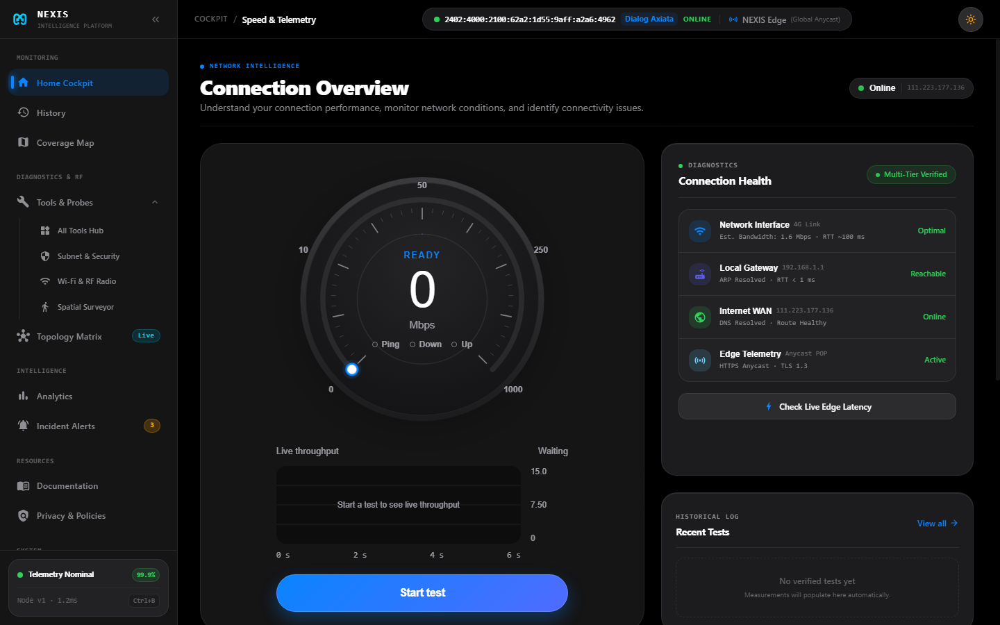
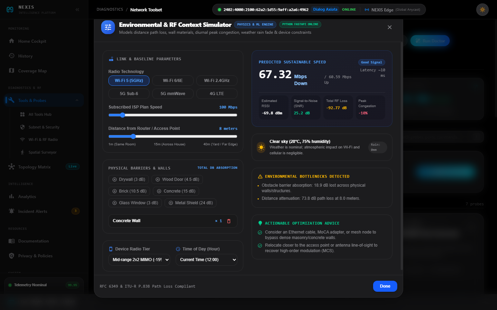
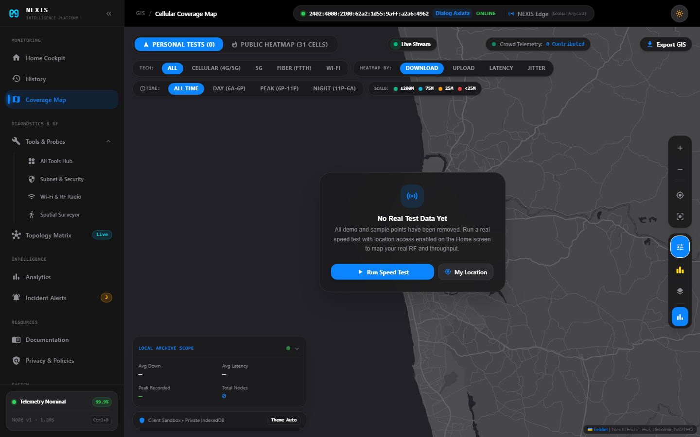
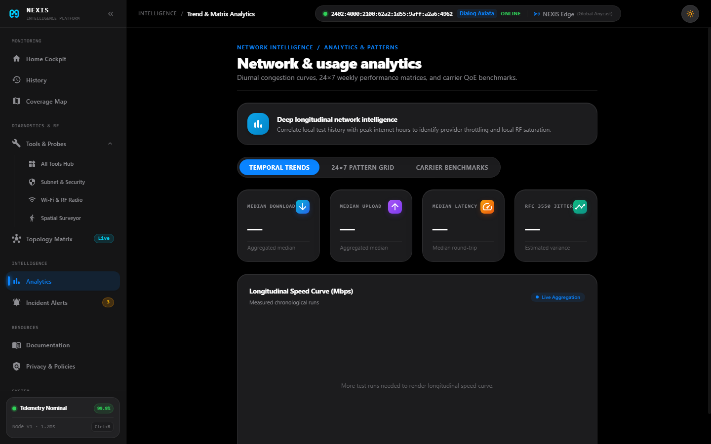
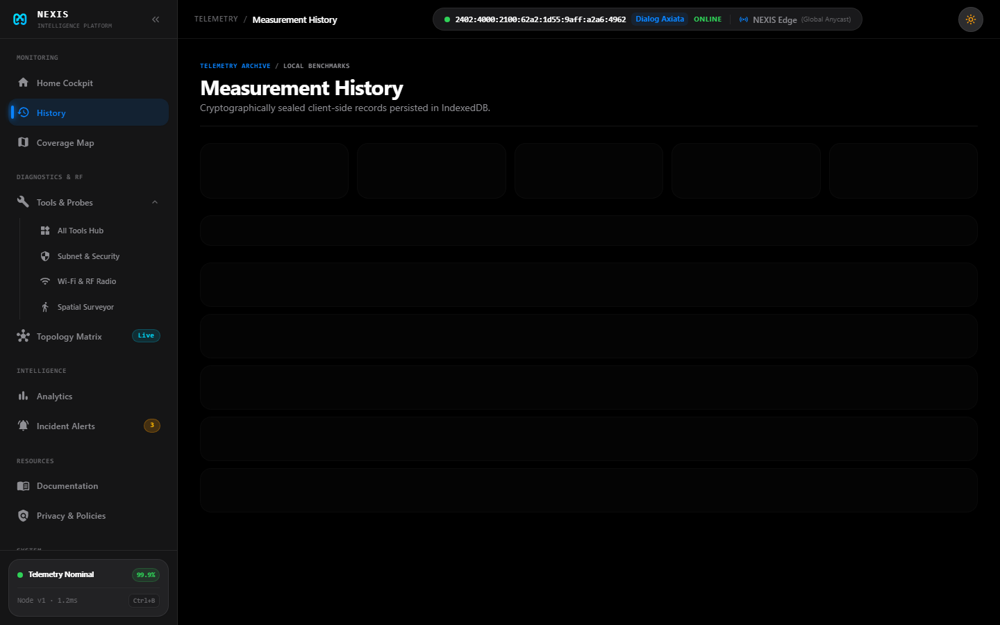
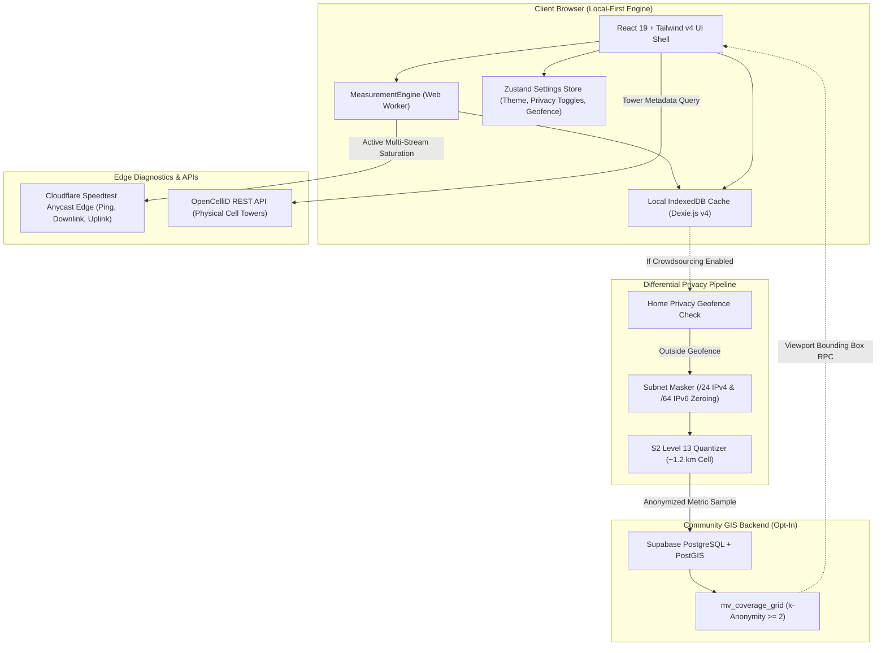

# NEXIS — Network Intelligence, Telemetry & GIS Coverage Platform

<p align="center">
  <strong>High-Precision Broadband Diagnostics &middot; Cellular Radio GIS &middot; Local-First Zero-Trust Architecture</strong>
</p>

<p align="center">
  
</p>

<p align="center">
  
  
  
  
  
  
  
  
</p>

---

## 📸 Interface Showcase

### 1. Precision Broadband & Bufferbloat Diagnostics
Real-time RFC 6349 multi-threaded throughput measurement, idle vs. loaded latency deltas, and ITU-T G.107 Quality of Experience (QoE) scores.


### 2. Environmental & RF Context Simulator
Simulate physical distance, wall materials (drywall, brick, concrete), diurnal peak-hour ISP congestion, and weather rain fade to predict sustainable throughput and pinpoint bottlenecks.


### 3. Cellular Radio & GIS Coverage Map
Interactive hardware-accelerated OpenCelliD cellular base stations (eNodeB/gNodeB) and crowdsourced S2 coverage grid.


### 4. Telemetry Analytics & Historical Trends
Longitudinal ISP stability charts, jitter distribution, bufferbloat grading trends, and percentile performance curves.


### 5. Zero-Trust Local Diagnostic History
Encrypted client-side IndexedDB persistence, CSV/JSON export, and instantaneous cryptographic purge.


---

## 🛰️ Overview

**NEXIS** is an enterprise-grade, browser-based network intelligence and cellular GIS coverage platform. Engineered with an Apple Studio-inspired glassmorphism interface and a zero-latency local-first execution model, NEXIS empowers network engineers, telecom professionals, and everyday subscribers to evaluate broadband throughput, bufferbloat queue latencies, Wi-Fi radio spectrums, and real-world cellular infrastructure without third-party tracking.

All measurements run inside client-side Web Workers, and diagnostic histories are stored locally on the user's machine using **IndexedDB (Dexie.js)**. When users choose to contribute to the community coverage map, differential privacy guarantees (Google S2 Level 13 polygonal discretization, IP subnet zeroing, and $k$-anonymity guardrails) mathematically prevent personal location tracking.

---

## ✨ Key Capabilities

| Capability | Technical Implementation | Standard / Methodology |
| :--- | :--- | :--- |
| **Broadband Speed Engine** | Multi-threaded HTTP chunk streaming via Cloudflare Anycast edge servers | **RFC 6349** TCP throughput testing |
| **Bufferbloat Analysis** | Real-time loaded vs. idle RTT latency delta (&Delta; RTT) | Active Queue Management (AQM) grading ($A+$ to $F$) |
| **Jitter & Packet Loss** | Continuous statistical interarrival variation filter | **RFC 3550** / **RFC 1889** low-pass smoothing |
| **Quality of Experience (QoE)** | Real-world application readiness evaluation | **ITU-T G.107** (4K Streaming, Cloud Gaming, VoIP) |
| **Cellular GIS Mapping** | Real tower lookups via OpenCelliD + S2 spatial grid indexing | Google S2 Geometry (Level 13, ~1.2 km resolution) |
| **Radio Diagnostics Suite** | 2.4/5 GHz Wi-Fi congestion analyzer, CIDR subnet scanner, port prober | IEEE 802.11 channel overlap matrix |
| **Privacy & Security** | Ephemeral probe ID rotation, /24 and /64 subnet zeroing, home geofencing | GDPR (EU 2016/679), CCPA/CPRA, Sri Lanka PDPA |

---

## 🏛️ Application Architecture



---

## 🚀 Quick Start

### Prerequisites
* **Node.js**: v20.x or higher
* **Python**: v3.10+ (for Environmental & RF Physics Backend)
* **Package Manager**: `pnpm` (recommended), `npm`, or `yarn`

### ⚡ One-Click Startup (Windows)
Double-click [`start.bat`](start.bat) from the root folder. It automatically provisions the Python virtual environment, installs dependencies, and boots both the FastAPI backend and Vite frontend!

---

### Manual Setup

#### 1. Clone & Install Frontend Dependencies

```bash
git clone https://github.com/SahanPramuditha-Dev/Nexis-Web.git
cd Nexis-Web
pnpm install
```

#### 2. Setup Python RF Diagnostic Backend

```bash
python -m venv backend/.venv
# Windows:
backend\.venv\Scripts\pip install -r backend/requirements.txt
# Linux/macOS:
source backend/.venv/bin/activate && pip install -r backend/requirements.txt
```

#### 3. Run Both Services

**Terminal 1 (Backend):**
```bash
npm run backend:venv
# Runs FastAPI on http://127.0.0.1:8000
```

**Terminal 2 (Frontend):**
```bash
npm run dev
# Runs Vite on http://localhost:5173
```

Copy `.env.example` to `.env`:

```bash
cp .env.example .env
```

Edit `.env` to configure your API keys (both are optional for standalone local testing):

```ini
# OpenCelliD API Token (Free registration at https://opencellid.org)
VITE_OPENCELLID_API_KEY=your_opencellid_api_key_here

# Supabase Configuration for Crowdsourced Cellular Mapping
VITE_SUPABASE_URL=https://your-project.supabase.co
VITE_SUPABASE_ANON_KEY=your_supabase_anon_public_key
```

> **Note:** If no OpenCelliD token is supplied, NEXIS automatically activates its high-fidelity bundled fallback base station dataset without throwing network errors.

### 3. Run Development Server

```bash
pnpm run dev
```

Open [http://localhost:5173](http://localhost:5173) in your browser.

### 4. Build for Production

```bash
pnpm run build
```

The output bundle will be generated in `dist/`, fully optimized with minified assets and sub-second build times.

### 5. Lint & Code Quality

```bash
pnpm run lint
```

Powered by **Oxlint** for ultra-fast, type-aware code analysis.

---

## 📂 Project Structure

```
nexis-web/
├── docs/                                  # Repository Documentation Hub
│   ├── ARCHITECTURE.md                    # Core system design & Web Worker engine
│   ├── PRIVACY_AND_SECURITY.md            # Differential privacy & S2 fuzzing spec
│   ├── GIS_AND_COVERAGE.md                # OpenCelliD & RF signal parameters
│   ├── MEASUREMENT_METHODOLOGY.md         # RFC 6349, bufferbloat & QoE math
│   └── DATABASE_SCHEMA.md                 # PostgreSQL + PostGIS DDL reference
├── public/                                # Public static assets & SVG marks
├── src/
│   ├── assets/                            # Brand logos, icons & imagery
│   ├── data/                              # Data access, storage & services
│   │   ├── carrierService.ts              # IP and Autonomous System (ASN) lookup
│   │   ├── db.ts                          # Dexie.js IndexedDB local database
│   │   ├── models.ts                      # Domain models, QoE scoring, CSV/JSON export
│   │   ├── openCellIdService.ts           # OpenCelliD tower search & caching
│   │   ├── supabaseClient.ts              # PostGIS crowdsourcing client
│   │   └── supabase_crowdsourcing_schema.sql # PostgreSQL + PostGIS DDL script
│   ├── design/                            # Apple Studio-grade Design System
│   │   ├── components/                    # Gauge cards, tiles, modals, toggles, shell
│   │   │   ├── NexisShell.tsx             # Responsive desktop/mobile shell & navigation
│   │   │   ├── NexisHeaderBar.tsx         # Dynamic island breadcrumb & live IP capsule
│   │   │   ├── SpeedometerGauge.tsx       # Canvas speedometer gauge
│   │   │   ├── QoEScorecardSection.tsx    # Gaming / Streaming / VoIP scorecards
│   │   │   └── VisualShareCardModal.tsx   # Diagnostic summary card generator
│   │   └── ...
│   ├── measurement/                       # Network engine & math algorithms
│   │   ├── engine.ts                      # Cloudflare speedtest orchestration
│   │   └── math.ts                        # Percentiles, rolling averages & jitter filter
│   ├── pages/                             # Application Route Pages
│   │   ├── home/                          # Primary cockpit & speedtest interface
│   │   ├── history/                       # Measurement records archive & breakdown
│   │   ├── map/                           # GIS cellular coverage heatmap & tower matrix
│   │   ├── topology/                      # Network subnet topology scanner
│   │   ├── tools/                         # CIDR calculator, Wi-Fi analyzer & probes
│   │   ├── analytics/                     # Carrier performance trend intelligence
│   │   ├── alerts/                        # SLA incident notifications feed
│   │   ├── settings/                      # Engine preferences, backup & privacy controls
│   │   ├── docs/                          # In-app interactive documentation hub (/docs)
│   │   └── legal/                         # Privacy policy, terms & transparency (/legal)
│   ├── stores/                            # Zustand reactive state stores
│   │   ├── historyStore.ts                # IndexedDB measurement records state
│   │   ├── measurementStore.ts            # Active live speed test telemetry state
│   │   └── settingsStore.ts               # Theme, privacy toggles & geofence state
│   ├── App.tsx                            # React Router v7 route definitions
│   ├── index.css                          # Tailwind CSS v4 design tokens & keyframes
│   └── main.tsx                           # Application entry point
├── package.json                           # Dependencies & scripts
├── tsconfig.json                          # TypeScript configuration
└── vite.config.ts                         # Vite 8 build configuration
```

---

## 🔒 Privacy, Security & Data Ethics

NEXIS is architected around the fundamental principle that network diagnostic utilities should never double as personal tracking instruments.

1. **Local-First Default:** All measurement data (speed runs, latency samples, bufferbloat logs) is saved exclusively in your browser's local **IndexedDB** database (`nexis_telemetry_db`).
2. **Zero Trackers / Zero Ads:** No Google Analytics, no Facebook Pixel, and no advertising cookies.
3. **Differential Geolocation Fuzzing:** When contributing to the community coverage map, coordinates are snapped to **Google S2 Level 13 polygons (~1.2 km resolution)**. Exact home or office coordinates are never written to disk or sent across the network.
4. **Subnet Masking (Host Zeroing):** Public IPv4 addresses have their host octet zeroed out (`192.0.2.0/24`), and IPv6 addresses have their 64-bit interface identifiers stripped (`2001:db8::/64`).
5. **Home Privacy Geofence:** Users can define a circular exclusion zone in Settings (e.g., 250m around their residence) that automatically inhibits crowdsourcing when testing on private premises.
6. **$k$-Anonymity Guardrails ($k \ge 2$):** Public cellular coverage maps query aggregated PostGIS materialized views that require measurements from at least 2 distinct devices before any cell is displayed.
7. **One-Click Data Portability & Erasure:** Users can export their complete measurement history to JSON/CSV or completely wipe local storage with one click from the Settings page.

For the full legal text, review our in-app [Privacy Policy](src/pages/legal/LegalPage.tsx) or access `/privacy` in the running application.

---

## 📚 Technical Documentation Hub

Detailed engineering references are available in the [`docs/`](docs/) directory:

* 📄 [**System Architecture & Engine**](docs/ARCHITECTURE.md) — Multi-threaded Web Worker architecture, stream pipeline, and state synchronization.
* 🛡️ [**Privacy & Differential Cryptography**](docs/PRIVACY_AND_SECURITY.md) — Mathematical specification of S2 quantization, subnet zeroing, and $k$-anonymity.
* 📡 [**GIS & Cellular Infrastructure**](docs/GIS_AND_COVERAGE.md) — OpenCelliD REST API, base station caching, and radio parameters (RSRP, RSRQ, SINR).
* 📐 [**Measurement Methodology**](docs/MEASUREMENT_METHODOLOGY.md) — RFC 6349 TCP throughput, bufferbloat delta formula, and ITU-T QoE utility weights.
* 🗄️ [**Database & PostGIS Schema**](docs/DATABASE_SCHEMA.md) — PostgreSQL DDL, spatial indexes, materialized views, and bounding box RPC functions.

---

## 📜 Standards & Compliance

* **RFC 6349**: Framework for TCP Throughput Testing
* **RFC 3550**: RTP A Transport Protocol for Real-Time Applications (Interarrival Jitter)
* **ITU-T G.107**: The E-model: a computational model for use in transmission planning
* **EU GDPR (2016/679)**: Data minimization (Art. 5c) and Privacy by Design (Art. 25)
* **California CCPA / CPRA**: Consumer privacy and opt-out transparency
* **Sri Lanka PDPA (No. 9 of 2022)**: Telecom subscriber metadata protection

---

## 📄 License

Distributed under the **MIT License**. See `LICENSE` for details.
All crowdsourced cellular coverage matrices are published under the **Open Database License (ODbL)** for community public benefit.
